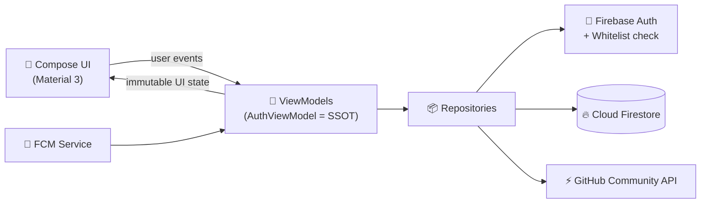

<div align="center">

# 🌐 HubSpace

### Where teams connect, plan, and move together.

A production-grade, multi-tenant team collaboration app built with **Jetpack Compose** and **Material Design 3**.

<br/>


</div>

<br/>

> [!WARNING]
> ### 🚧 Currently in active development phase.
> Once production-ready, this badge and beta notices will be removed.

<br/>

## ✨ Overview

**HubSpace** is a production-grade, multi-tenant team collaboration and workspace application for Android. It is built entirely with **Jetpack Compose** and **Material Design 3**, and backed by a secure Firebase stack.

Under the hood, HubSpace follows an enterprise-grade architecture centered on a **Single Source of Truth (SSOT)** pattern through `AuthViewModel`. Combined with **zero-flicker pre-fetching**, the UI renders fully formed on first paint, with no layout shifts and no duplicate Firestore reads.

<br/>

## 🧰 Tech Stack

<table>
  <tr>
    <td><b>Language</b></td>
    <td>
      
    </td>
  </tr>
  <tr>
    <td><b>UI Framework</b></td>
    <td>
      
      
    </td>
  </tr>
  <tr>
    <td><b>Architecture</b></td>
    <td>
      
      
      
    </td>
  </tr>
  <tr>
    <td><b>Backend &amp; Database</b></td>
    <td>
      
      
      
    </td>
  </tr>
  <tr>
    <td><b>Notifications</b></td>
    <td>
      
    </td>
  </tr>
  <tr>
    <td><b>Dev Environment</b></td>
    <td>
      
      
      
      
    </td>
  </tr>
</table>

<br/>

## 🚀 Features

### ✅ Implemented

| | Feature | Description |
|---|---|---|
| 🚀 | **Zero-Flicker Architecture** | Pre-fetched ViewModel state loading that eliminates layout shifts and duplicate Firestore reads. |
| 🏢 | **Multi-Team Workspace** | Seamless team switching with reactive state synchronization and custom team selection sheets. |
| 📊 | **Smart Daily Brief** | `SummarizeDayCard` gives a context-aware workspace pulse that highlights active tasks, upcoming deadlines, and notices. |
| ⚡ | **Live GitHub Activity** | `GitHubLiveCard` fetches contribution stats, streaks, and repository counts in real time using community APIs and coroutine-safe networking. |
| 🔔 | **FCM Push Notifications** | Background and killed-state push handling through a custom `FirebaseMessagingService`. |
| 🎨 | **Modern Material 3 Design** | Dynamic surfaces, custom vector branding icons, and refined typography. |
| 🔐 | **Secure Access** | Google Sign-In with whitelist verification, backed by Firebase Authentication. |

<br/>

## 🏗️ Architecture

HubSpace uses **MVVM** with **Clean Architecture** principles and a strict **Unidirectional Data Flow**. `AuthViewModel` acts as the Single Source of Truth for session and workspace state.



**Key principles**

- **Single Source of Truth:** one authoritative state holder, so screens never disagree with each other.
- **Unidirectional Data Flow:** events flow up, state flows down, which keeps behavior predictable and testable.
- **Pre-fetching:** data is loaded before the UI needs it, which removes flicker and redundant reads.

<br/>

## 🗺️ Roadmap

- [ ] 📋 **Dedicated Tasks Board:** full-fledged checkable team task lists with strike-through states and quick-add bottom sheets.
- [ ] 🔑 **Team Join by Hash Code:** 8-character invite code generation and validation for instant workspace onboarding.
- [ ] 🔗 **Notification Deep Linking:** direct intent routing from background push notifications to specific team announcements.
- [ ] 🤖 **Edge AI Task Parsing:** a natural language widget that parses and schedules events and tasks from plain text.

<br/>

## 📸 Screenshots

<!-- Replace the placeholders below with real screenshots, e.g. docs/screenshots/home.png -->

<div align="center">

| Home | Team Switcher | Daily Brief | GitHub Activity |
|:---:|:---:|:---:|:---:|
| *coming soon* | *coming soon* | *coming soon* | *coming soon* |

</div>

<br/>

## ⚙️ Getting Started

### Prerequisites

- **Android Studio** (latest stable)
- **JDK 17** or newer
- A **Firebase project** with Authentication, Firestore, and Cloud Messaging enabled

### Setup

```bash
# 1. Clone the repository
git clone https://github.com/<your-username>/HubSpace.git
cd HubSpace

# 2. Open in Android Studio and let Gradle sync
```

1. In the [Firebase Console](https://console.firebase.google.com/), create a project and add an Android app with the project's package name.
2. Enable **Google** as a sign-in provider under **Authentication**.
3. Add your debug and release **SHA-1 / SHA-256** fingerprints to the Firebase app settings.
4. Download `google-services.json` and place it in the `app/` directory.
5. Set up the **Firestore** whitelist data used for sign-in verification.
6. Build and run on a device or emulator.

```bash
./gradlew assembleDebug
```

> [!NOTE]
> `google-services.json` contains project-specific configuration. Keep it out of public version control by adding it to `.gitignore`.

<br/>

## 🤝 Contributing

Contributions, issues, and feature requests are welcome.

1. Fork the project
2. Create your feature branch: `git checkout -b feature/amazing-feature`
3. Commit your changes: `git commit -m "Add amazing feature"`
4. Push to the branch: `git push origin feature/amazing-feature`
5. Open a Pull Request

<br/>

## 📄 License

Distributed under the **MIT License**. See `LICENSE` for details.

<br/>

<div align="center">

**Built with ❤️ using Kotlin and Jetpack Compose**

⭐ If you like this project, consider giving it a star.

</div>